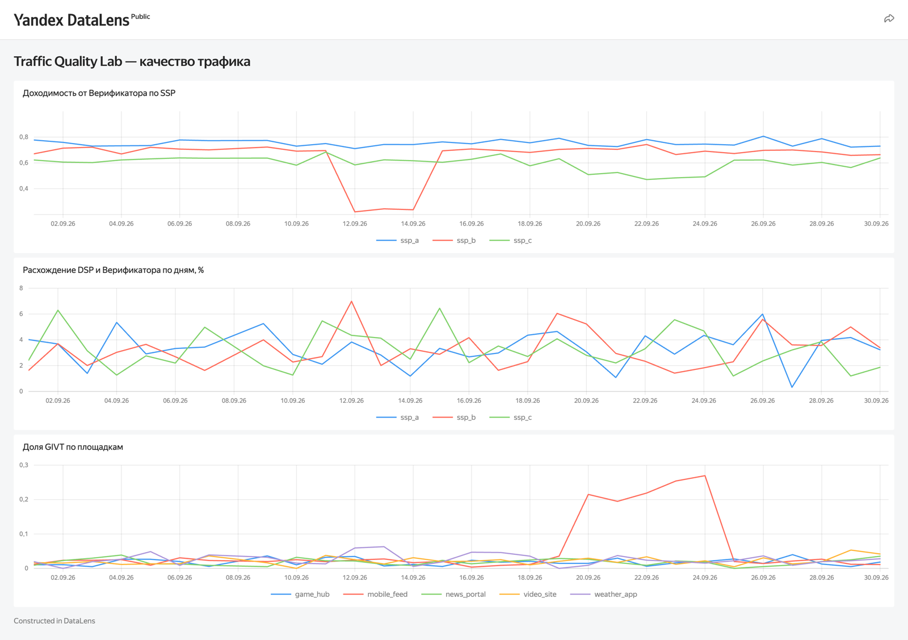
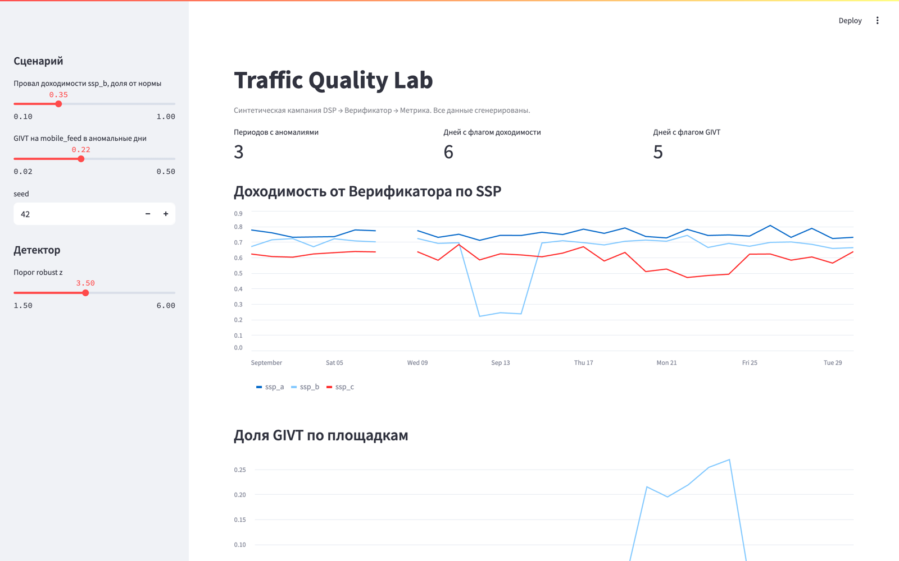

# Traffic Quality Lab

[Русская версия](README.md)

A synthetic lab for ad traffic quality analysis: **DSP → ad verifier → Yandex Metrika → report**.

The site, GTM events, visits and the DSP and verifier exports are all generated, with known anomalies built in. The pipeline cleans the data, computes click-to-visit reach and GIVT share, flags anomalies in daily time series and builds a highlighted report. Every metric is computed twice, in pandas and in SQL (DuckDB). Tests check that both match and that the pipeline finds exactly the anomalies that were planted, no more and no less.

**Links:** [case study (RU)](docs/case.md) · [DataLens dashboard](https://datalens.yandex/5eh8tse706g0o) · [Google Sheets report](https://docs.google.com/spreadsheets/d/1NhA2LwWcmlN6AD9Vxc3NhOupJ8nuMSW8UQ5RWQbEGQM/edit) · [live demo site](https://yzinchenko-data.github.io/traffic-quality-lab/)

[](https://datalens.yandex/5eh8tse706g0o)

<table>
<tr>
<td width="50%"><br><sub>Reach by SSP, flagged days marked</sub></td>
<td width="50%"><br><sub>GIVT share by placement</sub></td>
</tr>
</table>

## What it shows

- **Data cleaning:** duplicate rows, a "Total" row in the export, mixed date formats, a missing day, the same UTM spelled four ways.
- **Metrics:** reach = visits / verifier clicks (incl. IVT), DSP vs verifier gap by day and for the period, GIVT/SIVT share, CR with Wilson intervals, chi-square across SSPs.
- **Anomaly detection:** robust z-score (median/MAD, threshold 3.5), STL trend, consecutive flagged days merged into periods (gaps and islands in SQL).
- **Testing:** pandas = SQL, plus a ground-truth check against the planted scenarios.
- **Delivery:** Excel, Google Sheets built by Apps Script, a DataLens dashboard, a Streamlit app, and an on-demand GitHub Actions refresh.

## Quick start

```bash
pip install -r requirements-dev.txt
make report   # simulate → emulate Metrika → analyze → report
make test
make app      # Streamlit: tune the z threshold and anomaly strength
```



No keys are needed in offline mode. For live mode (a real Metrika counter and a Playwright bot visiting the site), see the Russian README.

## Planted anomalies

| Scenario | Planted | Found |
|---|---|---|
| `reach_drop` | ssp_b, Sep 12–14: reach at 35% of normal | reach 22–24% vs 70% on other days |
| `high_givt` | mobile_feed, Sep 20–24: GIVT 22% | GIVT spike, and the resulting reach drop on ssp_c |
| `goal_spike` | weather_app, Sep 17: +160 form submits | more goal hits than visits |
| `duplicates` | 6 duplicate DSP rows | removed and logged |
| `missing_date` | no Sep 8 in the verifier export | detected; ratios use only days present in both exports |
| `utm_noise` | `SSP_A`, `ssp-a`, `ssp_a?ref=feed` | normalized to `ssp_a` |

## Data

All data is synthetic. There are no real clients, campaigns, contractor UTM tags or numbers from real projects. Tokens live only in `.env` and GitHub Secrets.
