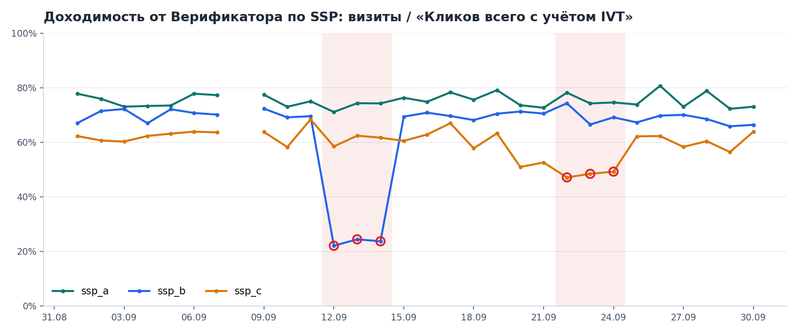
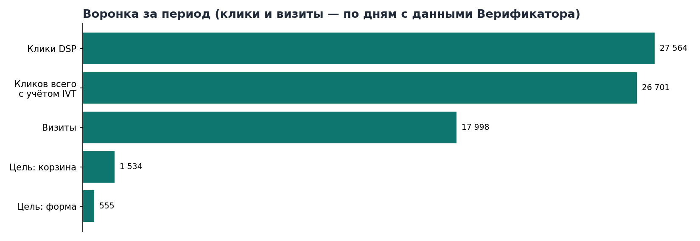
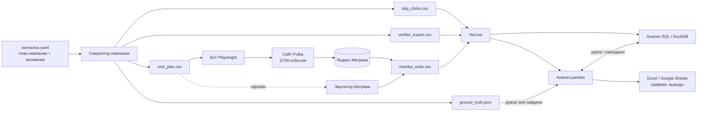
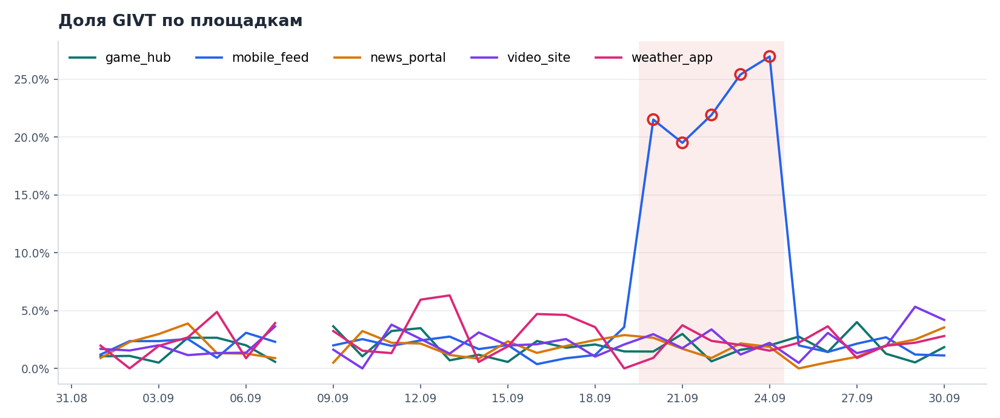
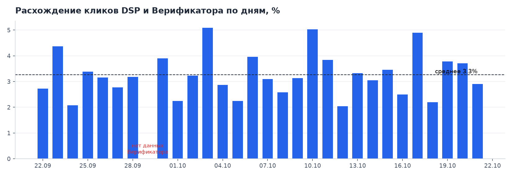

# Traffic Quality Lab


[](https://github.com/yzinchenko-data/traffic-quality-lab/actions/workflows/ci.yml)


Синтетический стенд для анализа качества рекламного трафика: **DSP → Верификатор → Метрика → отчёт**.

Сайт, GTM-события, визиты и выгрузки DSP и Верификатора генерируются, а в данные заранее вшиты аномалии. Пайплайн чистит данные, считает доходимость и долю GIVT, ищет аномалии во временных рядах и собирает отчёт с подсветкой. Каждая метрика посчитана дважды, в pandas и в SQL. Тесты проверяют, что оба расчёта совпадают и что найдено ровно то, что было вшито.





## Что внутри



| Слой | Что делает | Где |
|---|---|---|
| Симуляция | Клики DSP по дням, SSP и площадкам; выгрузка Верификатора с GIVT/SIVT; план визитов с UTM | [`src/simulate/campaign.py`](src/simulate/campaign.py) |
| Сайт | Витрина на GitHub Pages, события `add_to_cart`, `form_submit`, `scroll_50`, `click_phone` в dataLayer | [`site/`](site/), [`gtm/SETUP.md`](gtm/SETUP.md) |
| Трафик | Playwright проигрывает план визитов на сайте с UTM-метками | [`src/simulate/visitor.py`](src/simulate/visitor.py) |
| Выгрузка | Reporting API Метрики (Python) и выгрузка в Google Sheets (Apps Script) | [`src/extract/`](src/extract/), [`apps_script/`](apps_script/) |
| Чистка | Дубли, строка «Итого», форматы дат, пропущенные дни, UTM в разном написании | [`src/clean/loaders.py`](src/clean/loaders.py) |
| Анализ | Доходимость, расхождение DSP / Верификатор, GIVT, robust z, STL, интервалы Уилсона, хи-квадрат | [`src/analysis/`](src/analysis/) |
| SQL-дубль | Те же расчёты: CTE, оконные функции, `ROLLUP`, gaps and islands | [`sql/`](sql/) |
| Отчёт | Excel и Google Sheets с условным форматированием, графики, текст выводов | [`src/report/`](src/report/) |

## Быстрый старт

```bash
git clone https://github.com/yzinchenko-data/traffic-quality-lab.git
cd traffic-quality-lab
pip install -r requirements-dev.txt
make report   # симуляция → эмулятор Метрики → анализ → отчёт
make test     # 28 тестов
```

Ключи и доступы для офлайн-режима не нужны. После запуска:

- `reports/traffic_quality_report.xlsx` — отчёт на 6 листов с подсветкой;
- `reports/findings.md` — выводы текстом;
- `docs/img/*.png` — графики.

## Вшитые аномалии и что находит пайплайн

Сценарии описаны в [`scenarios.yaml`](scenarios.yaml). Их можно менять, тесты проверяют результат по `ground_truth.json`.

| Сценарий | Что вшито | Что находит пайплайн |
|---|---|---|
| `reach_drop` | ssp_b, 12–14.09: доходимость 35% от нормы | Провал доходимости ssp_b 12.09–14.09: 22–24% при 70% в остальные дни |
| `high_givt` | mobile_feed, 20–24.09: GIVT 22% | Рост GIVT на mobile_feed 20.09–24.09. Как следствие, просадка доходимости ssp_c 22–24.09: GIVT входит в «Кликов всего с учётом IVT», но до сайта не доходит |
| `goal_spike` | weather_app, 17.09: +160 отправок формы | Целей form_submit больше, чем визитов |
| `duplicates` | 6 полных дублей в выгрузке DSP | Удалены, записаны в отчёт о чистке |
| `missing_date` | В выгрузке Верификатора нет 08.09 | Дата найдена; расхождение и доходимость считаются только по дням, которые есть в обеих выгрузках |
| `utm_noise` | `SSP_A`, `ssp-a`, `ssp_a?ref=feed` | Приведены к `ssp_a` |





## Дашборд DataLens

[Traffic Quality Lab — качество трафика](https://datalens.ru/5eh8tse706g0o-traffic-quality-lab-kachestvo-trafika): доходимость от Верификатора по SSP, расхождение DSP и Верификатора по дням, доля GIVT по площадкам. Источник — CSV из папки [`datalens/`](datalens/), их выгружает пайплайн.

## Живой сайт и счётчик

Витрина: https://yzinchenko-data.github.io/traffic-quality-lab/. Подключены контейнер GTM `GTM-MJXVW5MB` и счётчик Метрики с целями `add_to_cart`, `form_submit`, `scroll_50`, `click_phone`; настройки контейнера лежат в [`gtm/container.json`](gtm/container.json).

## Как считается

**Доходимость от Верификатора** = визиты / «Кликов всего с учётом IVT». В числителе только визиты за дни, по которым есть выгрузка Верификатора.

**Расхождение DSP / Верификатор** = (клики DSP − клики Верификатора) / клики Верификатора. Считается по дням и за период, рядом выводится среднее по дням.

**Доли за период** пересчитываются из сумм, а не усредняются по дням.

**Аномалии.** Флаг ставит robust z: (x − медиана) / (MAD · 1,4826), порог 3,5. Медиана и MAD почти не сдвигаются от нескольких аномальных дней, поэтому трёхдневный провал не размывает собственную норму. STL-декомпозиция с недельным периодом идёт рядом как тренд для графиков. Флаг по ней не ставится: на 30 точках остаток почти нулевой, и любое колебание выглядело бы аномалией.

**Конверсии.** Для CR даётся 95% интервал Уилсона, SSP сравниваются хи-квадратом. Строки, где целей больше, чем визитов, в CR не попадают: они идут отдельной находкой.

### Пример SQL: склейка аномальных дней в периоды

```sql
WITH islands AS (
    SELECT *, date - CAST(ROW_NUMBER() OVER (PARTITION BY kind, slice ORDER BY date) AS INTEGER) AS grp
    FROM flagged
)
SELECT kind, slice, MIN(date) AS start, MAX(date) AS "end", COUNT(*) AS days
FROM islands
GROUP BY kind, slice, grp;
```

## Тесты

| Файл | Проверяет |
|---|---|
| `test_simulator.py` | Детерминизм по seed; «Итого» Верификатора = сумма строк; GIVT + SIVT + чистые = всего |
| `test_cleaning.py` | Нормализацию UTM, отчёт о чистке, уникальность ключей витрины |
| `test_python_vs_sql.py` | pandas и DuckDB дают одни и те же суммы, доли, флаги и периоды |
| `test_ground_truth.py` | Найдены все вшитые аномалии, лишних нет, каждый провал доходимости объяснён |
| `test_visitor_plan.py` | Бот проигрывает план с нужным числом целей и UTM |

## Живой режим: сайт, GTM и настоящие визиты

1. Включить GitHub Pages (Settings → Pages → GitHub Actions): workflow [`pages.yml`](.github/workflows/pages.yml) выложит `site/`.
2. Создать счётчик Метрики и контейнер GTM по [`gtm/SETUP.md`](gtm/SETUP.md), вписать ID контейнера в `site/assets/config.js`.
3. В Settings → Variables добавить `SITE_URL` и запустить вручную [`traffic.yml`](.github/workflows/traffic.yml): бот проиграет 5% плана за выбранную дату.
4. Заполнить `.env` по `.env.example` и запустить с настоящими данными:

```bash
python -m src.pipeline --source api            # визиты из Метрики
python -m src.pipeline --source api --sheets   # плюс выгрузка в Google Sheets
```

Визиты бота идут из headless-браузера с IP датацентра, и Метрика часть из них отметит как роботов. Это не прячется: роботность считается в отчёте отдельной колонкой.

## Структура

```
traffic-quality-lab/
├── scenarios.yaml          # план кампании и вшитые аномалии
├── site/                   # витрина Polka (HTML/CSS/JS, события dataLayer)
├── gtm/SETUP.md            # теги, триггеры и переменные GTM
├── apps_script/            # выгрузка Метрики в Google Sheets
├── src/
│   ├── simulate/           # симулятор кампании, бот-посетитель
│   ├── extract/            # Metrika API, офлайн-эмулятор, общая схема
│   ├── clean/              # чистка и отчёт о чистке
│   ├── analysis/           # доходимость, временные ряды, конверсии
│   ├── report/             # Excel, Google Sheets, графики, текст выводов
│   ├── sql_runner.py
│   └── pipeline.py
├── sql/                    # staging → витрина → аномалии (DuckDB)
├── tests/
└── .github/workflows/      # CI, деплой сайта, синтетический трафик
```

## Данные

Все данные в репозитории синтетические. Клиентов, кампаний, UTM-меток подрядчиков и цифр из реальных проектов здесь нет. Токены хранятся только в `.env` и GitHub Secrets.

## Лицензия

MIT
